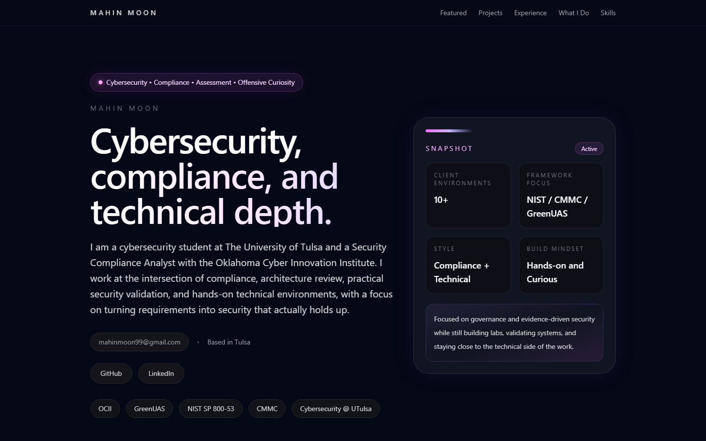
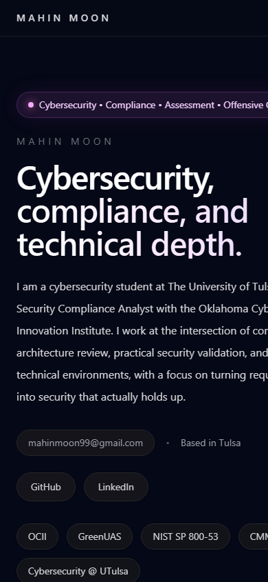

<p align="center">
  
</p>

<p align="center">
  <a href="https://xirro9.github.io/Portfolio/"><b>🌐 Visit the live site → xirro9.github.io/Portfolio</b></a>
</p>

---

## About

A personal cybersecurity portfolio showcasing my experience, projects and technical work.

I'm a cybersecurity student at The University of Tulsa and a Security Compliance Analyst at the Oklahoma Cyber
Innovation Institute. My work sits where compliance, technical validation and hands-on security environments meet.

<table>
  <tr>
    <td width="72%"></td>
    <td width="28%"></td>
  </tr>
</table>
<p align="center"><sub><b>Real screenshots</b> of the deployed site, desktop and mobile</sub></p>

## What's on the site

| Section | Contents |
|---|---|
| **Featured** | A spotlight project at the top of the page |
| **Projects** | Adversary simulation and detection environment, centralised logging and SIEM (Wazuh), segmented network lab, LifeDash (Hacklahoma), custom memory allocator, CLI text editor, incident response scripting, Docker WordPress deployment |
| **Experience** | Roles and education |
| **What I do** | How I approach security work: requirements → real controls → evidence |
| **Skills** | Frameworks, tooling and strengths |
| **Activities** | Competitive experience and team leadership (Hivestorm, CyberPatriot) |

### Focus areas

- NIST SP 800-53, CMMC and GreenUAS
- Security control assessment and evidence mapping
- Penetration testing and adversarial thinking
- Practical, testable security implementation

## Built with

| | |
|---|---|
| UI | React 19 (single `App.jsx` with data-driven sections) |
| Styling | Tailwind CSS 4 via `@tailwindcss/vite` |
| Build | Vite, with `base: '/Portfolio/'` for GitHub Pages |
| Quality | ESLint (React Hooks and Refresh plugins) |
| Deploy | GitHub Actions → GitHub Pages on every push to `main` (`.github/workflows/deploy.yml`) |

## Run it locally

```bash
npm ci
npm run dev        # local dev server
npm run build      # production build → dist/
npm run preview    # serve the production build
npm run lint
```

`npm ci` and `npm run build` were verified on Node 24 during this README update.

## Updating content

Experience, projects and skills are plain data arrays at the top of `src/App.jsx`. Edit them there and push to `main`;
the Pages workflow rebuilds and redeploys the site.
